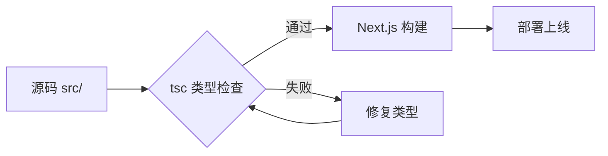

这是一篇示例文章，用于验证子目录层级、面包屑与 TOC 渲染。

## 严格模式

始终开启 `strict`：

```json
{
  "compilerOptions": {
    "strict": true
  }
}
```

## 路径别名

使用 `@/` 指向 `src` 目录。

## 构建流程示意



## 类型推导示例

行内公式示例：质能方程 $E = mc^2$，时间复杂度 $O(n \log n)$。

> [!NOTE]
> MDX 中行内公式不能直接包含 `{}`（会被解析为 JSX 表达式），复杂公式请使用 `math` 代码块。

```math
T = \arg\min_{\theta} \sum_{i=1}^{n} \mathcal{L}(f_\theta(x_i), y_i)
```
